<p align="center">
  
</p>

<h1 align="center">Athan</h1>

<p align="center">
  <b>Offline prayer times, athan and qibla for Android.</b><br>
  No account, no ads, no tracking. Works without the internet.
</p>

<p align="center">
  <a href="https://play.google.com/store/apps/details?id=com.ahmedkhalaf.athan"></a>
  <a href="../../releases/latest"></a>
  
  
  
</p>

---

<div dir="rtl" align="right">

## نبذة عن التطبيق

**أذان** تطبيق مجاني خفيف لمواقيت الصلاة، يعمل على هاتفك دون حاجة إلى إنترنت أو حساب. لا إعلانات فيه، ولا يجمع أي بيانات عنك.

<p align="center">
  <a href="https://play.google.com/store/apps/details?id=com.ahmedkhalaf.athan"><b>حمّله من Google Play</b></a>
</p>

### ما الذي يقدّمه

- **شاشة رئيسية واضحة** — الصلاة القادمة والوقت المتبقي لها داخل حلقة تمتلئ كلما اقترب الوقت، وجدول اليوم كاملًا بلمسة على «جميع الأوقات». وتتكيّف الشاشة مع حجم الهاتف ومع تكبير الخط.
- **مواقيت الصلاة دون إنترنت** — تُحسب على الجهاز نفسه من إحداثيات موقعك. ويختار التطبيق طريقة الحساب المعتمدة في بلدك تلقائيًا (ومنها المغرب والجزائر وتونس وتركيا)، ورابطة العالم الإسلامي حيث لا توجد طريقة خاصة، ويمكنك تغييرها متى شئت. مع تعديل عام حتى 120 دقيقة.
- **تعديل كل صلاة على حدة، ووقت الإقامة** — اضغط على أي صلاة لتقديمها أو تأخيرها دقائق، ولضبط الإقامة بعد الأذان. وبين الأذان والإقامة تتحوّل الحلقة في الشاشة الرئيسية إلى عدّاد تنازلي للإقامة.
- **الأذان في وقته** — لكل صلاة وضع مستقل: **صوت** أو **اهتزاز** أو **صامت**. ويُشغَّل الأذان بصوت المنبّه فيُسمع حتى لو خفّضتَ جرس الهاتف، وتظهر نافذته فوق شاشة القفل بزرّ إيقاف واحد.
- **تنبيه قبل الصلاة** — اختياري، من دقيقة إلى 60 دقيقة قبل دخول الوقت، بنغمة ومستوى صوت مستقلَّين عن الأذان، ويمكنك أن تختار تسجيلًا من هاتفك.
- **الفحص والتجربة** — شاشة في الإعدادات تبيّن هل كل شيء في هاتفك جاهز ليُرفع الأذان (الإشعارات، المنبّهات الدقيقة، الظهور فوق شاشة القفل، قيود البطارية، صوت المنبّه)، مع إصلاح أي خلل بلمسة، وزرّين لتسمع التنبيه والأذان الآن.
- **التقويم** — مواقيت أي شهر في جدول واحد، بالتقويم الميلادي أو الهجري (ورمضان منها)، تبدأ بالشهر الحالي ويمكنك اختيار أي تاريخ. يُشارَك ملفَّ PDF جاهزًا للطباعة أو صورةً أو جدولَ بيانات، ويمكنك إضافة ملاحظة على أي يوم.
- **أذكار الصباح والمساء** — مع عدد المرات لكل ذكر ومن رواه.
- **اتجاه القبلة** — بوصلة مصحَّحة إلى الشمال الحقيقي مع مراعاة الانحراف المغناطيسي، وعلامة الكعبة على القرص.
- **عربي وإنجليزي** — تُبدَّل اللغة من الشاشة الرئيسية مباشرة.
- **درجة الحرارة** — اختيارية، وهي الميزة الوحيدة التي تستعمل الإنترنت.

### لقطات من التطبيق

<p align="center">
  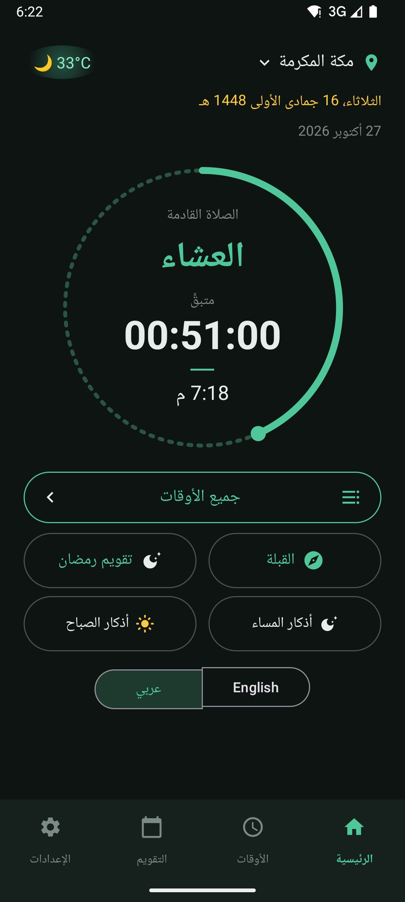
  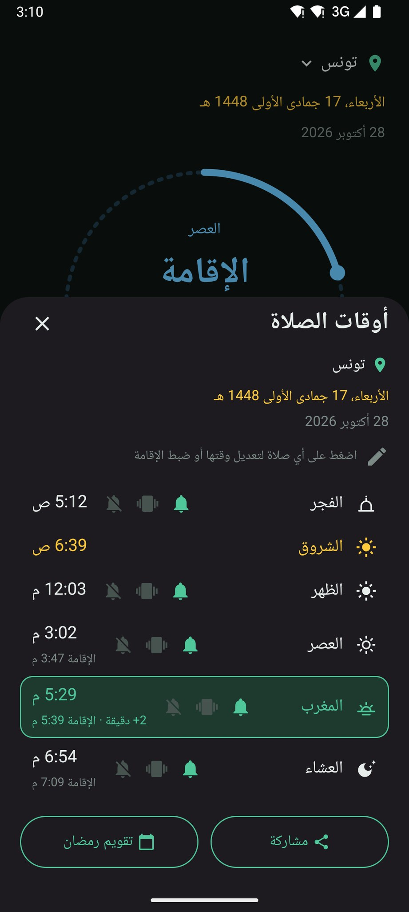
  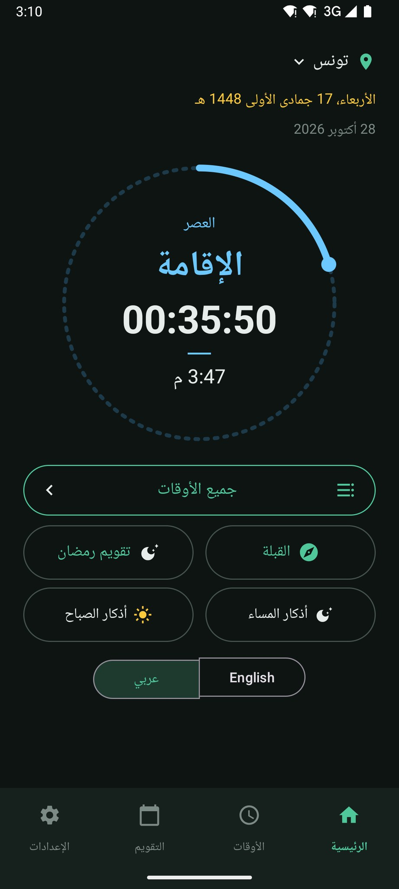
</p>
<p align="center">
  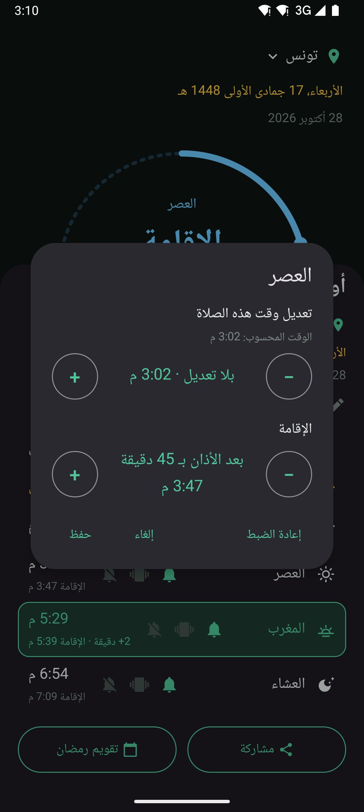
  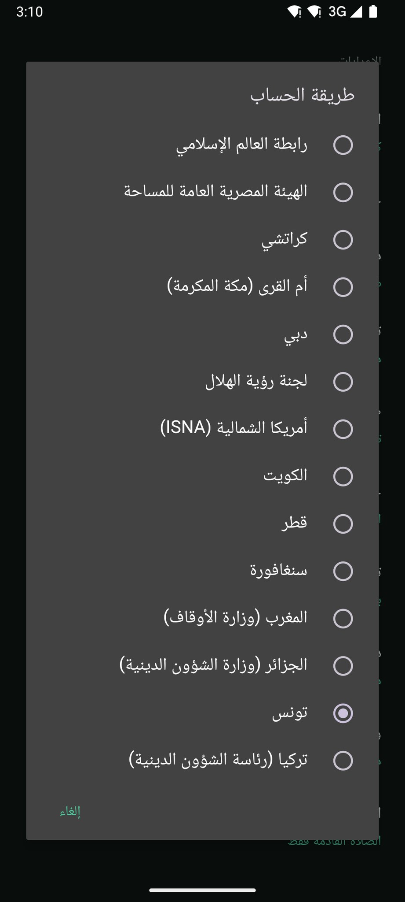
  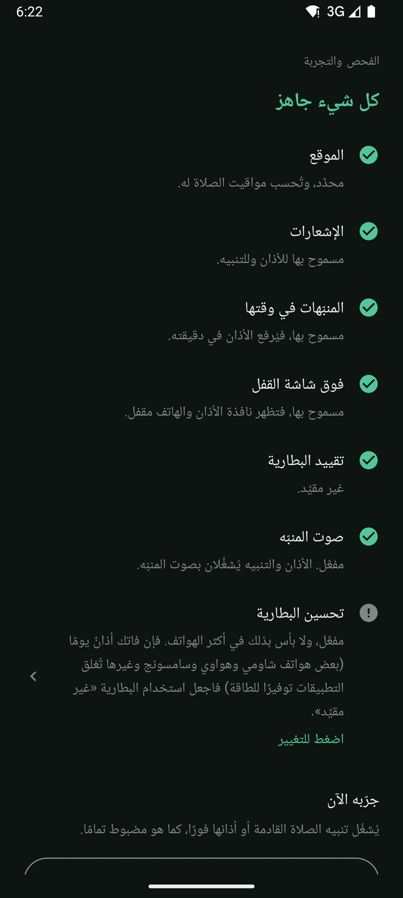
</p>
<p align="center">
  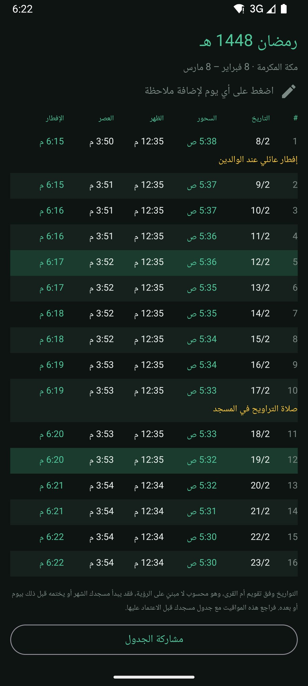
  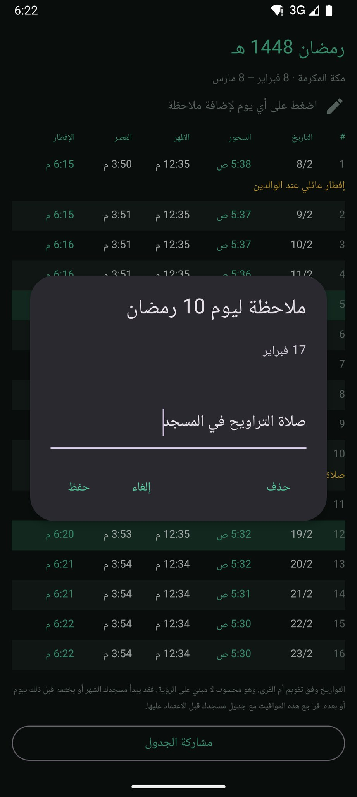
  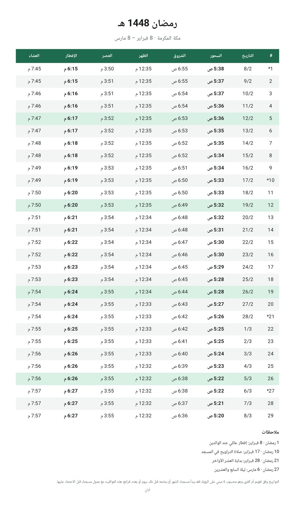
</p>

### عن تسجيلات الأذان

يضمّ التطبيق 29 تسجيلًا. ثلاثة منها بصوتي أنا: تسجيلان لصلوات الظهر والعصر والمغرب والعشاء، وتسجيل خاصّ بالفجر لما فيه من «الصلاة خير من النوم». وبقيّتها ممّا نشره موقع **إسلام ويب**، وقد أذِن الموقع في [الفتوى رقم 379009](https://www.islamweb.net/en/fatwa/379009/) بالانتفاع بمواده لغير أغراض تجاريّة بشرط ذكر المصدر ونسبته إليه — والتطبيق مجاني بلا إعلانات ولا مبيعات، وكلّ تسجيل منسوب إلى قارئه ومصدره في شاشة «المصادر والشكر» داخل الإعدادات.

وما لم يُؤذن فيه لم أُضمّنه: تسجيلات الحرمين من بثّ التلفزيون السعودي ليست ملكًا لإسلام ويب حتى يأذن فيها، فتُركت خارج التطبيق.

ولأنّ الأذواق تختلف، جعلتُ تغيير الصوت سهلًا: اختر أي ملف صوتي من هاتفك، أو افتح شاشة «مزيد من تسجيلات الأذان» التي تحيلك إلى مكتبات معروفة في المتصفّح — والتطبيق نفسه لا يُنزّل شيئًا ولا يستضيفه — ثم يظهر ما نزّلته ضمن «الأذانات المنزَّلة» لتختاره وتُثبّته.

### الخصوصية

لا يجمع التطبيق أي بيانات: لا تتبُّع، ولا إعلانات، ولا حساب. تُحفظ إحداثيات موقعك في إعدادات التطبيق على جهازك وحده، وتُستخدم لحساب المواقيت واتجاه القبلة. والميزة الوحيدة التي تتصل بالإنترنت هي درجة الحرارة: تُرسَل إحداثياتك إلى خدمة Open-Meteo لتعيد حالة الطقس، ويسألك التطبيق قبل ذلك مرة واحدة، ويمكنك إيقافها من الإعدادات فلا يتصل التطبيق بالشبكة إطلاقًا.

### التحميل والتثبيت

الأسهل من [**Google Play**](https://play.google.com/store/apps/details?id=com.ahmedkhalaf.athan)، وتصلك التحديثات تلقائيًا.

أو نزّل ملف `athan-v1.3.9.apk` من صفحة [الإصدارات](../../releases). عند فتحه سيطلب منك أندرويد السماح بالتثبيت من مصدر غير معروف، وهي رسالة معتادة لأي تطبيق يُثبَّت خارج المتجر. يتطلّب أندرويد 8.0 فأحدث، وحجمه نحو 35 ميجابايت.

ملاحظة: نسخة Google Play ونسخة GitHub موقَّعتان بمفتاحين مختلفين، فلا تُثبَّت إحداهما فوق الأخرى. للانتقال من نسخة GitHub إلى المتجر احذفها أولًا ثم ثبّت من المتجر.

### هل تنوي نشر تطبيقك على Google Play؟

كتبتُ من هذه التجربة [دليلًا عمليًا خطوة بخطوة](https://nandxorandor.github.io/Athan/google-play-guide.html) (بالإنجليزية): فتح حساب المطوّر، وتجهيز ملف ‎.aab وتوقيعه، والنماذج المطلوبة، وصفحة المتجر، والاختبار المغلق مع ١٢ مختبِرًا لمدة ١٤ يومًا، ثم النشر والتحديثات، مع الأخطاء التي وقعتُ فيها لتتجنّبها.

</div>

---

## In English

It calculates prayer times offline, plays the athan at the right moment (even
with the ringer down), and points to the qibla. Package
`com.ahmedkhalaf.athan`; free, and free of ads.
[**Get it on Google Play.**](https://play.google.com/store/apps/details?id=com.ahmedkhalaf.athan)

## Screenshots

<p align="center">
  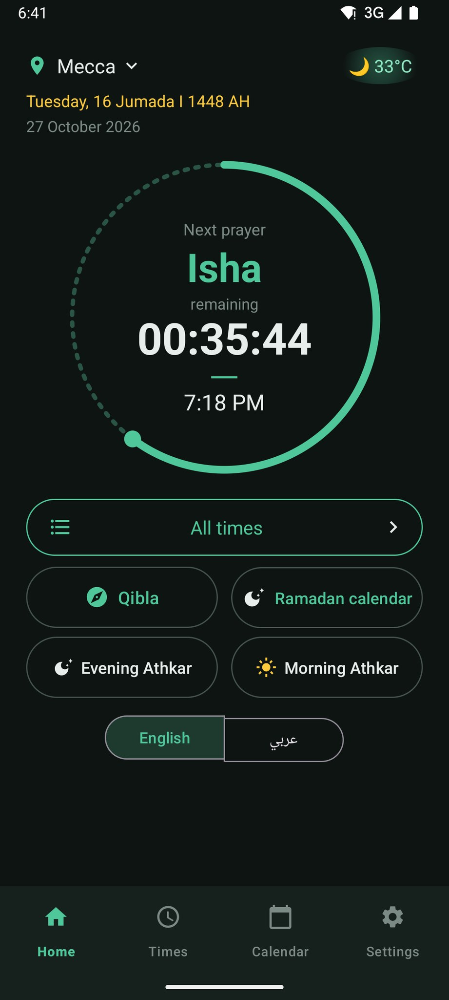
  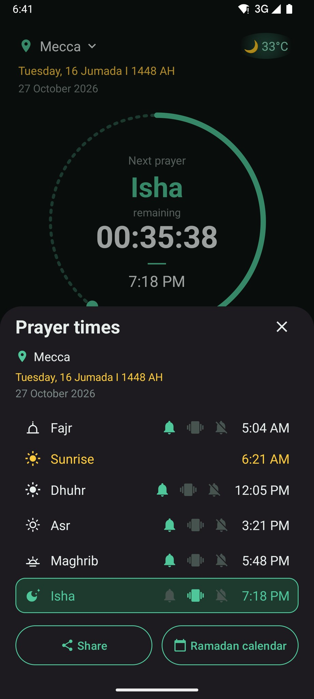
  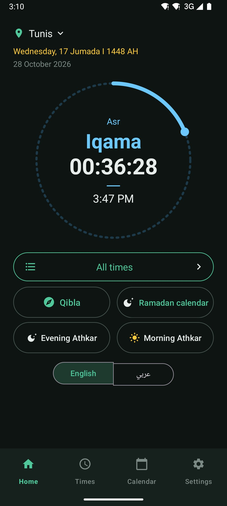
</p>
<p align="center">
  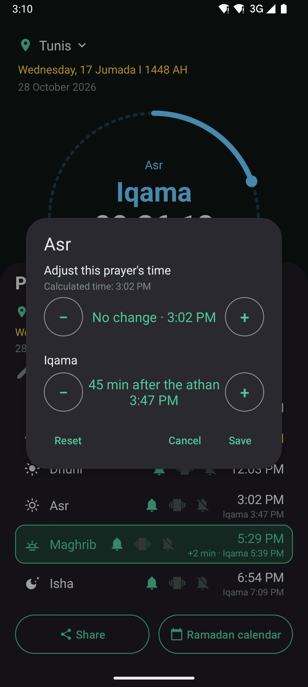
  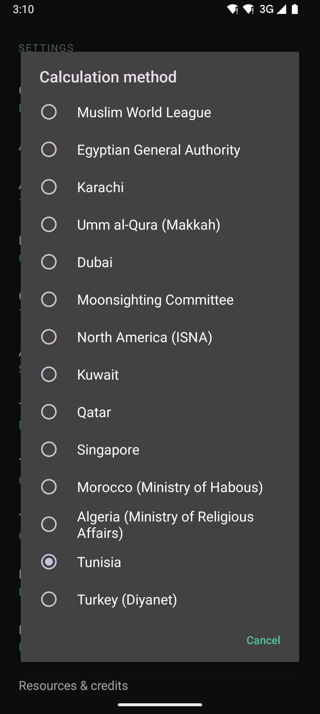
  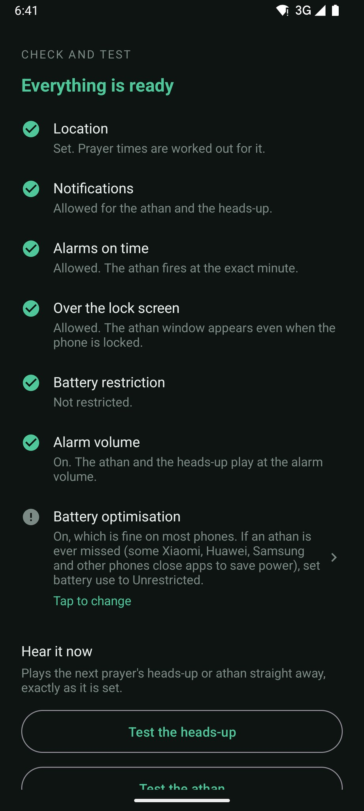
</p>
<p align="center">
  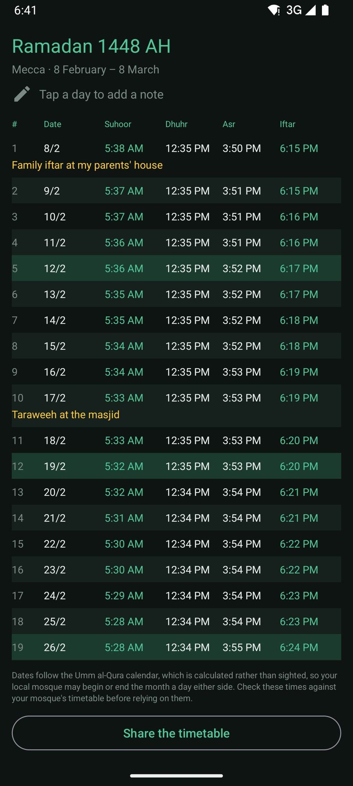
  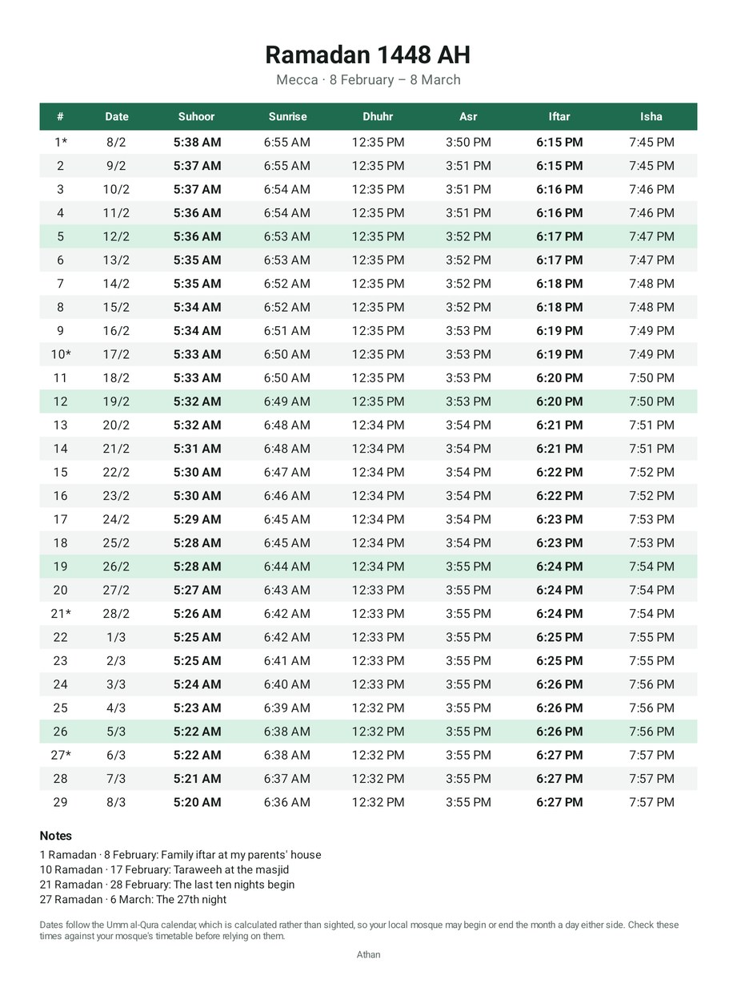
  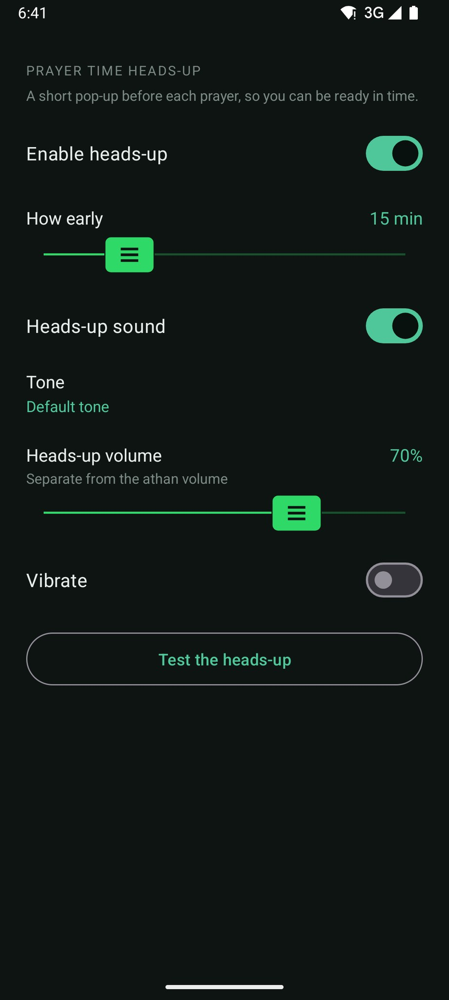
</p>
<p align="center">
  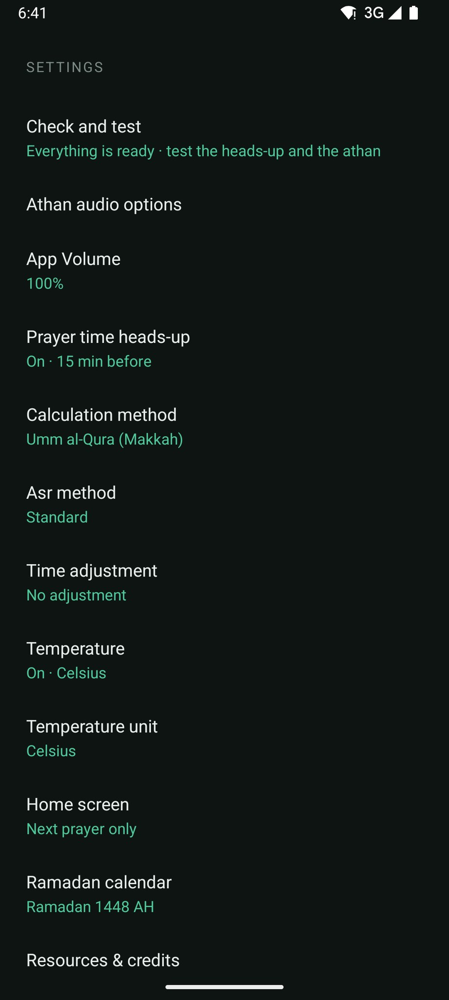
  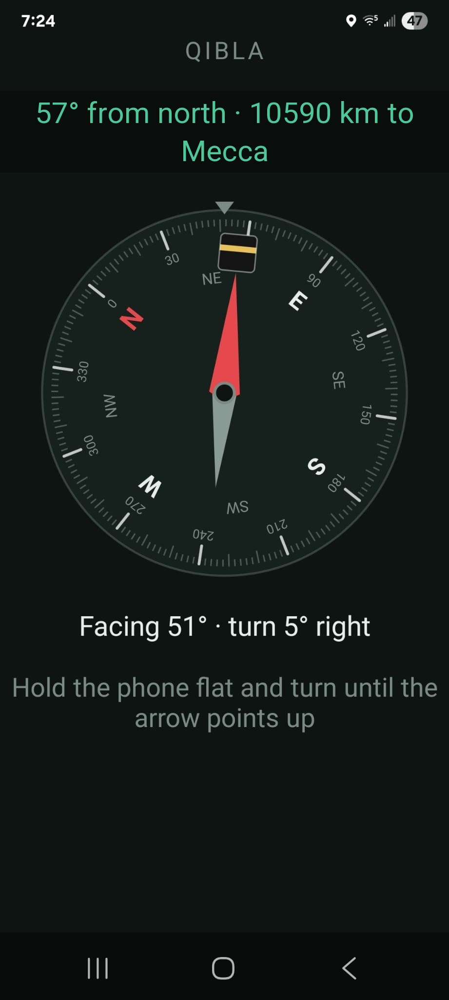
  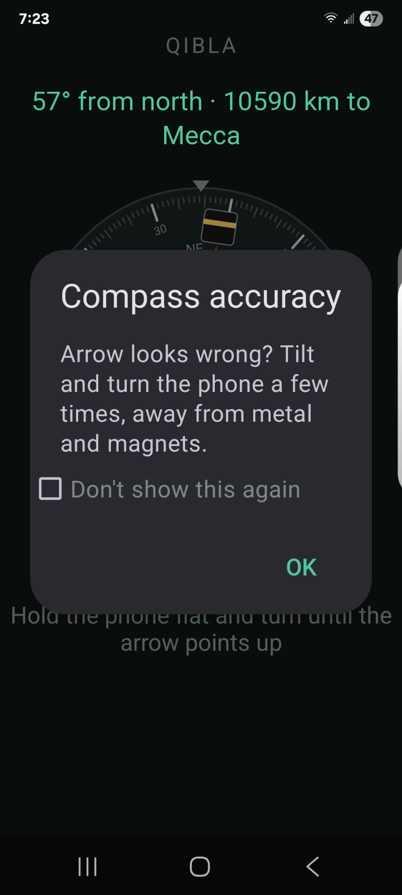
</p>
<p align="center">
  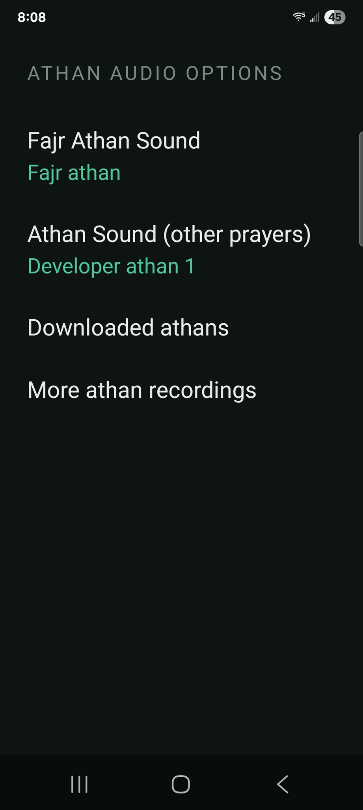
  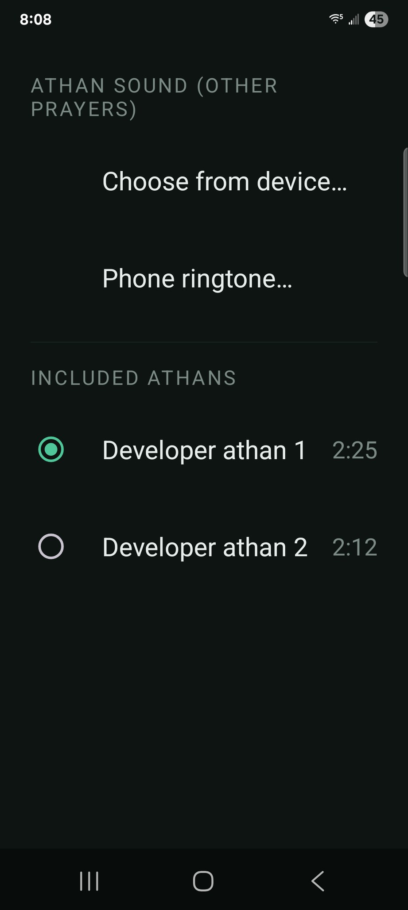
  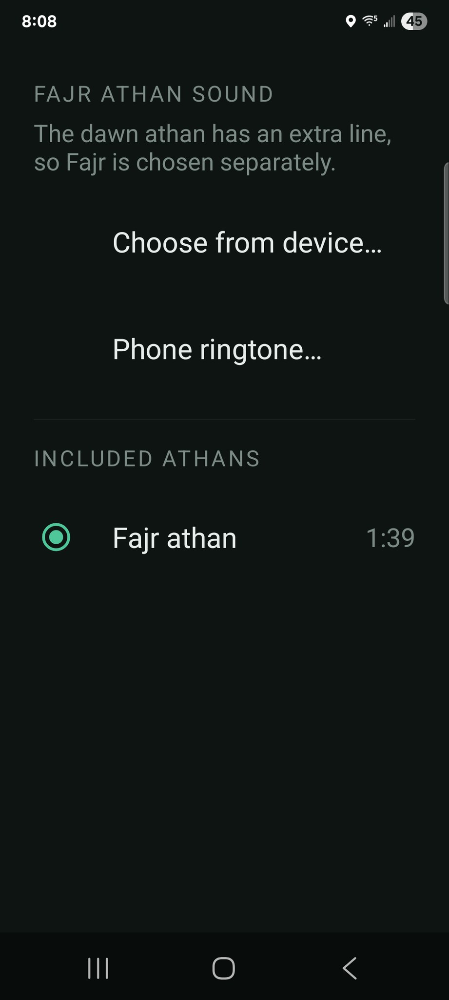
</p>
<p align="center">
  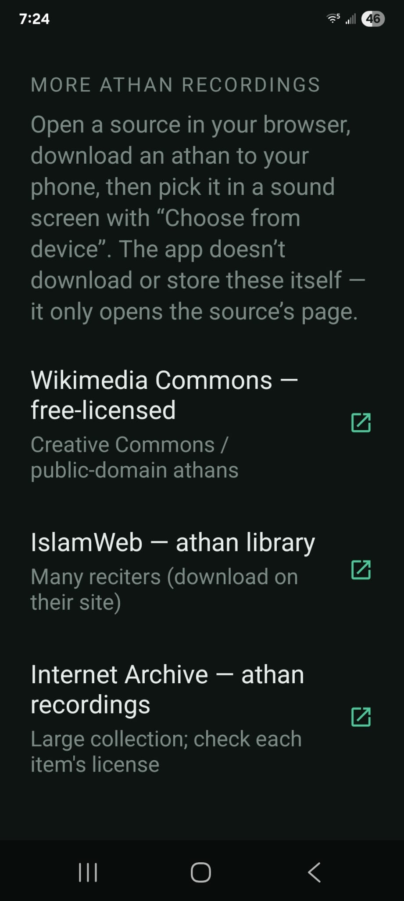
  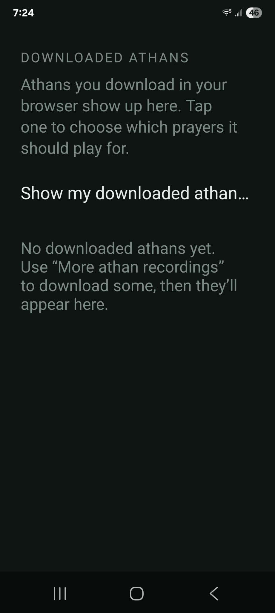
</p>

<p align="center"><sub>The newer screenshots are set to Mecca or Tunis; in the older ones location details are blacked out. The app keeps your location on the device only.</sub></p>

---

## Download and install

The easy way is [**Google Play**](https://play.google.com/store/apps/details?id=com.ahmedkhalaf.athan),
which also keeps it updated. The steps below are for installing the APK from
GitHub instead.

**1. Download the APK**

Go to the [**Releases**](../../releases) page and download `athan-v1.3.9.apk` from
the latest release. You can do this straight from your phone's browser.

**2. Allow the install**

Android blocks apps from outside the Play Store until you say otherwise. When you
tap the downloaded file you'll see a prompt like *"For your security, your phone
isn't allowed to install unknown apps from this source."*

- Tap **Settings** in that prompt
- Turn on **Allow from this source** (this permission belongs to the browser or
  file manager you downloaded with, not to Athan)
- Press back, then tap **Install**

You only do this once. It's the normal prompt for any app installed outside the
Play Store — nothing specific to this app.

**3. Play Protect may warn you**

Google scans unknown apps and may show *"Unsafe app blocked"* or *"App scan
recommended"*. This is Play Protect telling you it has never seen this app
before, not that it found anything. Tap **More details → Install anyway** (or
**Scan app**) if you want to continue.

**4. First run**

- Set your location (the app asks once and stores the coordinates locally)
- Grant the **notification** permission so the athan can appear over the lock
  screen
- If your phone asks about **alarms & reminders**, allow it — that is what lets
  the athan fire at the exact minute rather than whenever the system feels like it

### Updating later

Download the newer APK and install it over the top. Your settings are kept.
Every GitHub release is signed with the same key, so updates install cleanly.

Google Play signs its copy with Google's own key, so the Play version and the
GitHub APK cannot be installed over each other. To move from the APK to Google
Play, uninstall the APK first (this clears its settings), then install from Play.

### If you'd rather not install an APK

You can also build it yourself from this source — see [Building](#building-from-source).

---

## What it does

**The next prayer, at a glance.** The home screen shows the next prayer and the
time left, inside a ring that fills as it approaches. Today's full table is one
tap away under *All times*. The layout fits itself to the phone, including large
text sizes and display zoom. Prefer the table on the screen itself? Settings ->
Home screen -> Full timetable.

**Prayer times, fully offline.** Computed with the
[adhan](https://github.com/batoulapps/adhan-java) library from your coordinates.
The calculation method follows your country when you set your location
(Umm al-Qura in Saudi Arabia, the Egyptian authority in Egypt, Morocco, Algeria,
Tunisia, Turkey and others; Muslim World League elsewhere) until you pick one
yourself. Madhab is selectable, and there is a ±120-minute overall adjustment.

**Per-prayer adjustment and iqama.** Tap a prayer to move it on its own, for a
mosque that differs on one prayer, and to set its iqama in minutes after the
athan. Between the athan and the iqama the home screen's ring turns blue and
counts down to the iqama.

**The athan actually plays.** Each prayer is set to **Sound**, **Vibrate**, or
**Silent** independently — tap the row to change it. Sound plays on the alarm
audio stream, so it is audible with the ringer turned down, and the athan window
appears over the lock screen with a single Stop button.

**Reliable scheduling.** Uses `AlarmManager.setAlarmClock`, the one tier Android's
Doze mode never delays. Alarms are re-armed after each prayer, after a reboot,
and after a timezone change or the clock being set.

**Pre-prayer heads-up.** Optional reminder anywhere from 1 to 60 minutes before
each prayer, with its own tone (any sound on the phone, including your own
recording) or vibration, and its own volume, separate from the athan's. It
banners while you are using the phone and opens a full window when the screen is
locked.

**Check and test.** The first row in Settings lists everything on the phone that
can silently stop an athan (notifications, exact alarms, showing over the lock
screen, a Restricted battery setting, a muted alarm volume), each with a tap to
fix it, and plays the next prayer's heads-up or athan on demand, exactly as it is
set.

**Monthly calendar.** Any month's prayer times in one table, in the Gregorian
or the Hijri calendar (Ramadan included). It opens on this month; the arrows
or a date picker go anywhere else. Share it as a one-page PDF ready to print,
an image, or a spreadsheet. Tap any day to add a note; notes go out with the
timetable.

**Morning and evening athkar**, with how many times each is said and who
narrated it.

**Qibla compass.** True-north corrected (magnetic declination is applied), with a
Kaaba marker on the dial. Falls back to showing the bearing in degrees if your
phone has no magnetometer.

**Sunrise** is displayed for reference, and never fires an athan.

**Arabic and English**, switched from the home screen.

**Temperature (optional).** The current temperature and sky, and an umbrella if
rain is coming. The only feature that uses the internet; see [Privacy](#privacy).

---

## About the athan recordings

**29 recordings ship with the app**, from two sources.

**Three are my own** — *Developer athan 1* and *2* for Dhuhr, Asr, Maghrib and
Isha, and a *Fajr* recording carrying *aṣ-ṣalātu khayrun min an-nawm*.

**The rest were published by IslamWeb** (islamweb.net). IslamWeb permits its
material to be used for non-commercial purposes provided the source is named —
[fatwa no. 379009](https://www.islamweb.net/en/fatwa/379009/). This app is free,
carries no ads and sells nothing, and every recording is credited to its reciter
and source in the app under **Settings → Resources & credits**. That screen is
generated from the shipped audio index, so it cannot list a recording the app
does not have, or miss one it does.

**What is deliberately not included:** the Mecca and Madina recordings. Those are
Saudi state broadcasts — IslamWeb hosts them but does not own them, so its
permission does not extend to them. Attribution is not a licence, and a credit
line does not create a right to redistribute.

Not to your taste? The app makes it easy to use something else:

- **Settings → Athan audio options → Fajr Athan Sound / Athan Sound (other
  prayers) → Choose from device…** — any audio file already on your phone
- **Phone ringtone…** — any ringtone or notification tone
- **Settings → Athan audio options → More athan recordings** — opens IslamWeb's
  library in your **browser**. The app never downloads or hosts audio itself; you
  download what you want, the app tells you when it lands, and it appears under
  **Downloaded athans** ready to assign.

---

## Privacy

**Nothing is collected.** There is no analytics SDK, no crash reporter, no ad
network and no account. Your coordinates are stored in the app's own private
settings and used for the astronomy calculations.

The one exception is the optional temperature: to show it, your coordinates are
sent to [Open-Meteo](https://open-meteo.com/), which returns the weather. The app
asks once before doing this, and turning it off in Settings → Temperature stops
all network requests. Full details are in the
[privacy policy](docs/privacy-policy.html).

Permissions and why they exist:

| Permission | Why |
|---|---|
| Location (coarse/fine) | To compute prayer times and the qibla bearing. Optional — you can enter a city instead. |
| Notifications | Required to show the athan and reminder |
| Exact alarms | To fire the athan at the exact minute |
| Full-screen intent | To show the athan window over the lock screen |
| Foreground service (media playback) | Android requires one to play the athan reliably |
| Read audio | Only to list athan files you downloaded yourself. Nothing is uploaded. |
| Internet | Only for the optional temperature (Open-Meteo). Off means no network use at all. |
| Vibrate, wake lock, boot completed | Vibration mode, waking the screen, re-arming alarms after a restart |

---

## Building from source

```bash
git clone https://github.com/nandxorandor/Athan.git
cd Athan
./gradlew assembleDebug
```

Requires JDK 17+ and the Android SDK (compileSdk 36, build-tools 35.0.1).
The debug build needs no signing setup.

The bundled audio is generated from source recordings by `tools/sync-audio.ps1`,
which re-encodes anything above 100 kbps to 96 kbps mono and writes the index the
app reads at runtime — durations, and each recording's reciter and source, taken
from its own ID3 tags. The credits screen is built from that index, so attribution
is generated rather than typed and cannot drift out of step with what ships. The
processed assets are committed, so you do not need to run it unless you are
adding recordings of your own.

---

## Licence

**Source code:** [MIT](LICENSE).

**Audio** — not covered by the MIT licence:
- The three `Developer_Athan-*` recordings are mine, under CC BY 4.0.
- Every other recording was published by IslamWeb and is included under its
  non-commercial-with-attribution permission ([fatwa no.
  379009](https://www.islamweb.net/en/fatwa/379009/)). They remain the property
  of their reciters and of IslamWeb, are **not** relicensed here, and may not be
  used commercially. If you fork this repo, either honour those terms or delete
  the files.

**Launcher artwork:** © 2026 Ahmed Khalaf, all rights reserved.

## Publishing your own app?

<p align="center">
  <a href="https://nandxorandor.github.io/Athan/google-play-guide.html">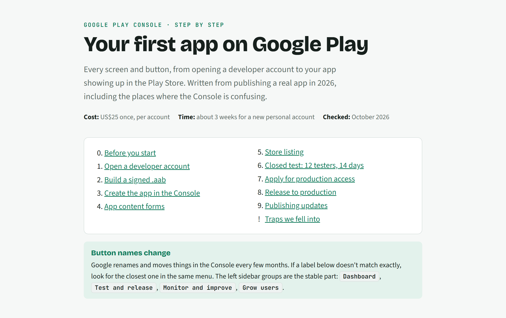</a>
</p>

[**Your first app on Google Play**](https://nandxorandor.github.io/Athan/google-play-guide.html) is a click-by-click guide written from
publishing this app: opening a developer account, building and signing the
`.aab`, every App content form, the store listing, the 12-tester / 14-day closed
test, the production release and updates, plus the traps we fell into along the
way.

## Contact

Ahmed Khalaf — ahmedkhalaf1@yahoo.com · [github.com/nandxorandor](https://github.com/nandxorandor)

Bug reports and suggestions are welcome in [Issues](../../issues).
